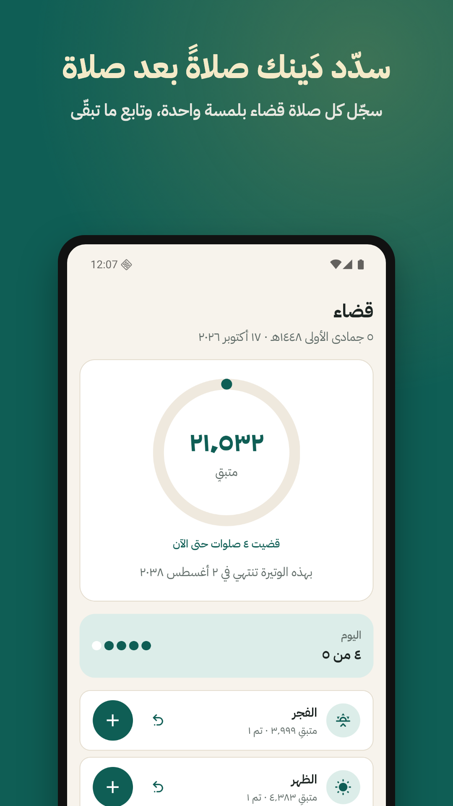
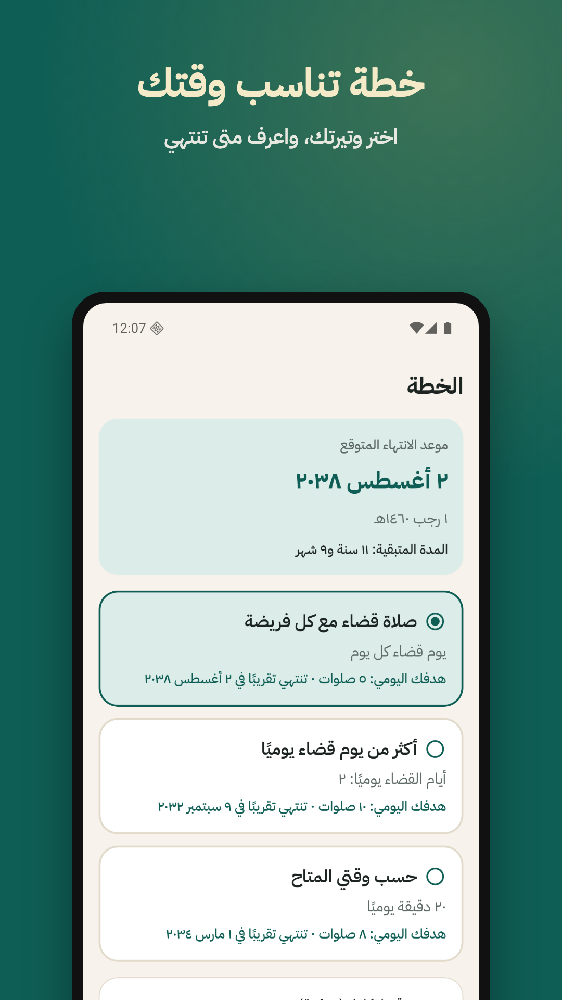
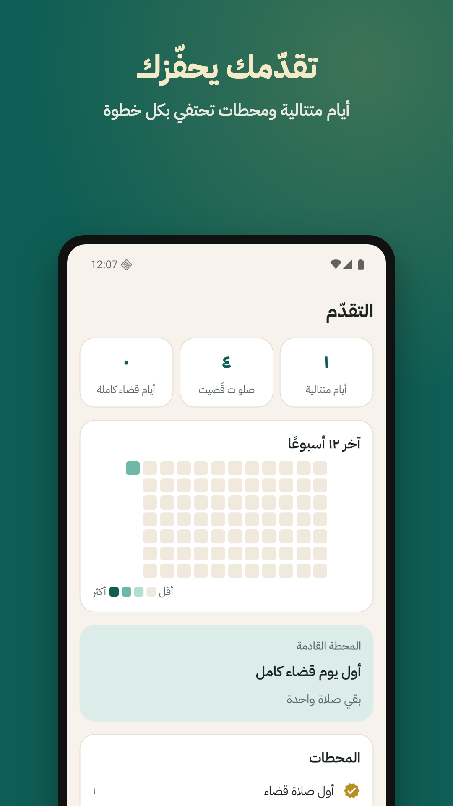

<div align="center">
  

# قضاء · Qadaa

**تتبّع قضاء الصلوات الفائتة وخطّط له — مجاني، بلا إعلانات، وبياناتك على جهازك.**

A free, private Android app to estimate, track and plan making up missed prayers.
Built as a sadaqah jariyah.

[](https://github.com/MAboyadak/qadaa-app/actions/workflows/ci.yml)




</div>

## Features
- **Estimate** what you missed from the periods of your life (puberty → regular prayer), including hayd/nifas for women.
- **Log** each make-up prayer with one tap, with undo and milestone encouragement.
- **Plan** a daily pace and see the projected finish date.
- **Reminders** after each prayer time (from location or a city list, offline) with a "prayed it ✓" action, plus dhikr reminders.
- Arabic (RTL) and English, light and dark themes, JSON backup export/import.
- **No accounts, no analytics, no network calls.** Everything stays in on-device SQLite.

## Status
Feature-complete MVP, tested on an Android emulator. Before the Play Store release:
- [ ] Scholar review of [`docs/fiqh-rules.md`](docs/fiqh-rules.md) (items marked ⚠ VERIFY) and `src/content/*.json`
- [ ] Play Console account and the 14-day closed test
- [ ] Contact email and hosted [privacy policy](docs/store/privacy-policy.md)

The fiqh approach (tawbah + qada, Witr off by default) is explained in [`docs/fiqh-rules.md`](docs/fiqh-rules.md)
and [`docs/DECISIONS.md`](docs/DECISIONS.md). The app never issues rulings of its own.

## Development
Expo SDK 58 · React Native · TypeScript · expo-router · expo-sqlite · adhan

```sh
npm install
npm test            # domain logic (estimate, ledger, plan, Hijri, Arabic counts)
npm run typecheck
npm run lint
npx expo run:android
```

See [`docs/dev-setup.md`](docs/dev-setup.md) for the Android SDK/emulator setup and [`CLAUDE.md`](CLAUDE.md) for project rules.

| Doc | What's in it |
|---|---|
| [`docs/PRD.md`](docs/PRD.md) | Goals, scope, features |
| [`docs/user-flows.md`](docs/user-flows.md) | Screens and flows |
| [`docs/data-model.md`](docs/data-model.md) | SQLite schema, append-only ledger |
| [`docs/design.md`](docs/design.md) | Design tokens and components |
| [`video/`](video) | Remotion launch video |

## CI
Every push and PR runs typecheck, lint, Jest and an Android JS bundle. Pushes to `main` also build a release APK
(downloadable from the run's artifacts). Pushing a `v*` tag publishes the APK as a GitHub pre-release.

## License
[MIT](LICENSE). Content (adhkar, hadith and sources) is quoted from the references cited in the app.
